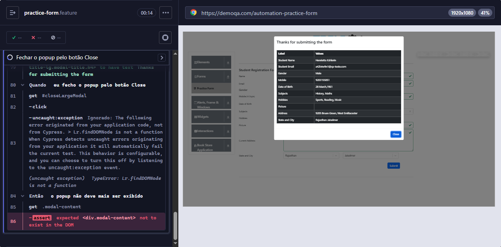
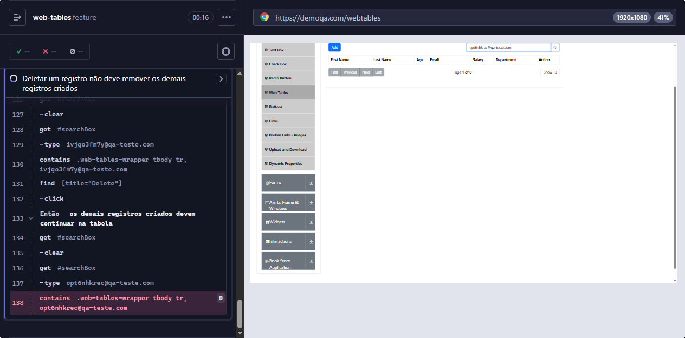

# Defeitos conhecidos no DemoQA

Defeitos encontrados no sistema sob teste (https://demoqa.com) durante a automação do desafio. Os cenários que os expõem ficam com a tag `@known-bug`, **fora da execução padrão**. Para executá-los: `npm run test:known-bugs`.

**Como ler este documento**

- **Severidade:** avaliação do autor deste projeto, pelo impacto para o usuário (Alta: perde dados que não escolheu apagar; Média: o usuário contorna, mas o componente falha; Baixa: ocorrência intermitente e de efeito limitado).
- **Status "Aberto":** o defeito estava presente na última execução. O DemoQA é um site de terceiros e não temos como corrigi-lo.
- **Reproduzido neste projeto:** "Sim" quando um cenário nosso falhou pelo defeito; "Não" quando a informação vem de observação e ainda não foi confirmada aqui.

## Resumo

| ID                                                 | Tela          | Severidade | Status | Reproduzido neste projeto | Cenário                                                                                   |
| -------------------------------------------------- | ------------- | ---------- | ------ | ------------------------- | ----------------------------------------------------------------------------------------- |
| [BUG-01](#bug-01--botão-close-não-fecha-o-popup)   | Practice Form | Média      | Aberto | Sim (24/10/2026)          | `practice-form.feature` → _Fechar o popup pelo botão Close_                               |
| [BUG-02](#bug-02--deletar-remove-outros-registros) | Web Tables    | Alta       | Aberto | Sim (24/10/2026)          | `web-tables.feature` → _Deletar um registro não deve remover os demais registros criados_ |
| [BUG-03](#bug-03--reset-em-100-reinicia-a-barra)   | Progress Bar  | Baixa      | Aberto | Não (observação)          | Mitigado no passo de reset de `progress-bar.feature`                                      |

---

## BUG-01 — Botão Close não fecha o popup

| Campo                  | Valor                                                                                              |
| ---------------------- | -------------------------------------------------------------------------------------------------- |
| **Severidade**         | Média: o usuário não consegue dispensar o popup com o botão feito para isso (a tecla Esc funciona) |
| **Status**             | Aberto                                                                                             |
| **Encontrado em**      | 24/10/2026                                                                                         |
| **Ambiente**           | https://demoqa.com/automation-practice-form, Chrome 155 (headless), Cypress 16.2.0, Windows        |
| **Teste automatizado** | `practice-form.feature` → _Fechar o popup pelo botão Close_ (`@known-bug`)                         |

**Passos para reproduzir**

1. Abrir https://demoqa.com, escolher **Forms** e depois **Practice Form**.
2. Preencher os campos obrigatórios e clicar em **Submit**.
3. No popup "Thanks for submitting the form", clicar em **Close**.

**Resultado esperado:** o popup fecha.

**Resultado observado:** o popup permanece aberto.

**Investigação**

| Verificação               | Resultado                                                                  |
| ------------------------- | -------------------------------------------------------------------------- |
| Clique no botão **Close** | O popup continua no DOM (`div.modal-content`) mesmo após 8 s de tentativas |
| Tecla **Esc**             | Fecha o popup: o componente fecha, o problema está no botão                |

**Causa provável:** o tratamento do clique em **Close** deve lançar `TypeError: ... findDOMNode is not a function`. A API `findDOMNode` foi removida no React 19, e o componente do popup parece ainda depender dela. _Isto não foi confirmado neste projeto; para confirmar, abra o console do navegador (F12) e clique em Close._

**Tratamento na automação:** o passo de fechamento do desafio usa **Esc**. O clique no botão fica no cenário `@known-bug`. Em `cypress/support/utils/pageNoise.js` só são ignorados o erro `findDOMNode` e erros de scripts de outros domínios (`Script error.`, típicos de anúncios); qualquer outro erro derruba o teste.

**Evidência** (execução de 24/10/2026): o cenário falhou com `Expected <div.modal-content> not to exist in the DOM, but it was continuously found`.

---

## BUG-02 — Deletar remove outros registros

| Campo                  | Valor                                                                                                    |
| ---------------------- | -------------------------------------------------------------------------------------------------------- |
| **Severidade**         | Alta: o usuário perde registros que não escolheu excluir                                                 |
| **Status**             | Aberto                                                                                                   |
| **Encontrado em**      | 24/10/2026                                                                                               |
| **Ambiente**           | https://demoqa.com/webtables, Chrome 155 (headless), Cypress 16.2.0, Windows                             |
| **Teste automatizado** | `web-tables.feature` → _Deletar um registro não deve remover os demais registros criados_ (`@known-bug`) |

**Passos para reproduzir**

1. Criar 3 registros com e-mails diferentes.
2. Pesquisar pelo e-mail do primeiro registro criado e clicar em **Delete** nele.
3. Conferir a tabela (limpando a pesquisa).

**Resultado esperado:** só o registro selecionado é removido.

**Resultado observado:** os demais registros criados deixam de aparecer (a busca por eles não encontra nada).

**Causa provável:** a exclusão parece operar sobre uma cópia desatualizada da lista de registros e, por isso, remove os que foram adicionados desde o carregamento da página. _Diagnóstico relatado em outros projetos; não verificado por nós no código do site._

**Tratamento na automação:** o bônus (12 registros) valida o **resultado final** pedido pelo desafio: nenhum registro criado permanece e os originais são preservados. Como o primeiro Delete já remove os outros, o passo "deletar todos" clica apenas nos registros ainda listados e registra no log os que já foram removidos. Isso **não comprova** a exclusão individual com vários registros; o cenário `@known-bug` cobre essa expectativa.

**Evidência** (execução de 24/10/2026): o cenário falhou ao procurar um dos registros criados depois do primeiro (`Expected to find content: '<e-mail>' within the selector: '.web-tables-wrapper tbody tr' but never did`).

---

## BUG-03 — Reset em 100% reinicia a barra

| Campo                  | Valor                                                                                     |
| ---------------------- | ----------------------------------------------------------------------------------------- |
| **Severidade**         | Baixa: ocorre numa janela de ~100 ms, de efeito limitado                                  |
| **Status**             | Aberto (observação)                                                                       |
| **Reproduzido aqui**   | **Não.** Informação vinda de observações em outros projetos; ainda não confirmada neste   |
| **Ambiente**           | https://demoqa.com/progress-bar                                                           |
| **Teste automatizado** | Mitigado em `progress-bar.feature` (passo `eu aguardo a barra de progresso atingir 100%`) |

**Passos para reproduzir**

1. Abrir **Widgets** → **Progress Bar** e clicar em **Start**.
2. Clicar em **Reset** assim que a barra mostrar 100%.

**Resultado esperado:** a barra volta a 0% e fica parada.

**Resultado observado (relatado):** a barra volta a 0% e recomeça sozinha.

**Causa provável:** a tela mostra 100% e o botão Reset um tick (~100 ms) **antes** de o timer ser cancelado. Resetar nessa janela pode deixar o timer vivo. Em outros projetos, esse comportamento fez o teste passar localmente e falhar no CI, onde o clique caiu na janela.

**Tratamento na automação:** antes de resetar, o teste espera o cancelamento do timer (spy em `clearInterval`) e só então clica em Reset. Depois valida que o valor é exatamente `0`.

**Como confirmar (a fazer):** num teste temporário, trocar a espera pelo cancelamento do timer por um clique imediato em Reset ao chegar em 100% e repetir a execução várias vezes. Se a barra reiniciar, anexar o screenshot aqui e passar o campo "Reproduzido aqui" para **Sim**.
